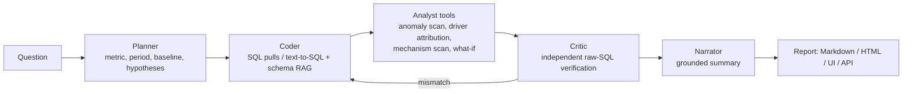

# Autonomous AI Data Analyst Agent

An agent that **investigates** a business question the way a senior analyst would, instead of just answering it.

```
$ python -m analyst investigate "Why did revenue drop in Q3?"      # output abridged

Revenue fell 10.3% in Q3 2024 vs Q2 2024 ($1.11M to $997.1K, -$114.7K).
- Where it came from: repeat customers in the West region moved -$149.8K, more than the entire net
  change (-$114.7K), because the rest of the business moved +$35.0K.
- Volume vs value: lower order volume accounts for -$129.5K; basket value accounts for +$14.8K.
- Likely mechanism: average delivery time for that segment went from 4.2 to 7.5 days (+3.3 days) versus
  +0.1 days for the rest of the business (z = 61). Review rating also fell from 4.3 to 3.3 stars.
  This is a strong association, not proof of causation.
- Context: versus last year, Q3 2024 revenue was -1.3% (the preceding quarter was +16.9%).
- What-if (estimate): cutting delivery time by 20% in West could have added about $58.7K ($53.3K to $64.2K).
- Confidence: high. 7 of 7 verification checks passed (re-derived from raw tables with independent SQL).
```

Open `reports/sample-q3-investigation.html` for the full report with interactive charts.

## Design principle: the LLM never does arithmetic

| Layer | Who | What |
|---|---|---|
| Language | LLM (optional) | interpret the question, write SQL for ad-hoc questions, write the summary |
| Numbers | SQL + pandas | every figure is computed by deterministic code |
| Trust | Critic agent | re-derives the numbers from raw tables with *independently written* SQL, checks that segments add up, checks sample size and significance |
| Guard rail | Narrator check | an LLM summary is **rejected** if it contains any number not present in the verified facts |

It runs **fully offline with no API key** (rule-based planner / SQL / template narrator). With `ANTHROPIC_API_KEY` set,
the Planner, text-to-SQL Coder and Narrator use Claude.

## Architecture



| Component | File | Notes |
|---|---|---|
| Planner | `analyst/agents.py` | rule parser; optionally refined by the LLM into validated JSON |
| Coder | `analyst/agents.py`, `analyst/rules_sql.py` | schema RAG, draft, execute, **self-repair on SQL errors / empty results** (max 3), optional sandboxed pandas post-processing |
| SQL gateway | `analyst/db.py` | single SELECT/WITH only, blocklist, DuckDB external access disabled and config locked |
| Schema RAG | `analyst/schema_rag.py` | TF-IDF with light stemming over schema + `glossary.json` ("revenue", "churn", "active customer"...) |
| Anomaly detection | `analyst/tools/anomaly.py` | seasonality-safe: scan statistic on year-over-year growth + Isolation Forest second opinion |
| Root cause | `analyst/tools/drivers.py` | greedy drill-down with an *excess-concentration* test, volume/price split, difference-in-differences mechanism scan |
| What-if | `analyst/tools/whatif.py` | two-way fixed-effects elasticity on a region x week panel, with CI and extrapolation flag |
| Critic | `analyst/critic.py` | 7 checks, drives the confidence label |
| Sandbox | `analyst/sandbox.py` | AST allow-list + isolated subprocess + rlimits + timeout |
| Orchestrator | `analyst/agent.py` | the agent loop, with a recompute round if the Critic finds a mismatch |

### Things worth knowing (and good to explain in an interview)

- **Seasonality is not an anomaly.** Detection runs on YoY growth of per-day values, so the Nov/Dec peak is ignored.
  A scan statistic (best contiguous window vs the rest) finds the multi-month incident that single-month z-scores miss.
- **"Big segment" is not "driver".** A segment only counts if it carries *more* of the movement than its share of the base
  (`excess = (share_of_movement - share_of_base) / (1 - share_of_base)`). On the seasonal Q1 decline the agent correctly says
  *broad-based* instead of blaming the largest segment.
- **It abstains.** Asked why revenue dropped in Q4 2024 (it rose 49%), it says there is no drop to explain.
- **Mechanism = difference-in-differences.** The metric change in the affected slice minus the change everywhere else,
  standardised with a Welch-style standard error. Causation is never claimed.

## Quickstart (macOS / Linux)

```bash
cd ai-data-analyst-agent
python3 -m venv .venv && source .venv/bin/activate
pip install -r requirements.txt
cp .env.example .env            # optional: add ANTHROPIC_API_KEY to enable LLM mode

python -m analyst investigate "Why did revenue drop in Q3?" --report --trace   # data is generated on first run
python -m analyst ask "Top 3 categories by revenue in Q3 2024"
python -m analyst whatif --reduction 0.3 --region West
streamlit run app/streamlit_app.py       # UI with charts, trace and verification panel
uvicorn api.main:app --reload            # REST API, docs at http://127.0.0.1:8000/docs
pytest -q                                # 46 tests
```

`make demo`, `make app`, `make api`, `make test`, `make eval` do the same.

## The demo dataset (with a known answer)

`analyst/data_gen.py` simulates two years of e-commerce (68k orders, 14k customers, 120 products) and **injects a known cause**:
from Jul to Sep 2024, deliveries to the **West** slowed by ~3.3 days and **repeat customers** there ordered ~65% less. Seasonality, growth
and a small Fashion promo are included as red herrings. Ground truth is written to `data/ground_truth.json`, so the agent can be scored.
To use your own data, load your tables into DuckDB and edit `VIEWS_SQL` in `analyst/db.py`, `knowledge.py` and `glossary.json`.

## Evaluation

`python -m eval.run_eval` (add `--offline` to force the baseline).

**Measured here, offline rule-based baseline (no LLM):**

| Benchmark | Result |
|---|---|
| Text-to-SQL execution accuracy, 50 questions | **39/50 = 78%** (easy 90%, medium 93%, hard 20%) |
| Root-cause cases vs injected ground truth (6 positive, 2 negative controls) | **8/8** |

**LLM mode:** not yet measured. Run `make eval` with your key and record it here:

| Mode | Text-to-SQL accuracy | easy / medium / hard |
|---|---|---|
| Rule-based baseline | 78% | 90% / 93% / 20% |
| Claude (`ANALYST_MODEL`) | _fill in_ | _fill in_ |

Honest reading of these numbers: the root-cause score shows the pipeline is *correct on a case where the truth is known*; because I
designed that dataset, it is not evidence of generalisation to arbitrary data. The 50 SQL questions use gold SQL written independently of
the agent; the hard ones (ratios, multi-step CTEs, "both years") are where an LLM should beat the baseline.

## Limitations

- LLM-mode code paths (planner refinement, text-to-SQL, narrator) are covered by tests with a scripted fake model, but were **not run against the live API during development**. Run `make eval` once with your key and check the trace.
- Investigations pull order-level rows into pandas, which is fine for ~100k-1M rows; for a warehouse, push the aggregations into SQL.
- Mechanism and what-if results are observational. The what-if elasticity comes from one regional slowdown episode, so treat the output as an estimate (the tool flags extrapolation).
- The sandbox is defence in depth, not a security boundary. For untrusted use, run the app in a container with restricted network and filesystem.
- Metrics supported by `investigate`: revenue and order count. Other metrics go through `ask`.

## Project layout

```
analyst/        agents, orchestrator, critic, tools/ (anomaly, drivers, whatif), db, rag, sandbox, report, cli
app/            Streamlit UI          api/   FastAPI service
eval/           50-question set, root-cause cases, runner, saved results
tests/          46 tests (SQL safety, sandbox, anomaly, root cause, critic tamper test, repair loop, grounding, API)
reports/        sample HTML report    data/  generated on first run
```

## Resume / interview framing

> Built an autonomous analyst agent (multi-agent: planner, text-to-SQL coder with schema RAG, critic, narrator) that investigates
> metric changes end to end: seasonality-aware anomaly detection, segment drill-down, difference-in-differences mechanism analysis and a
> what-if elasticity model. A critic re-derives every number from raw tables and LLM summaries are rejected if they contain ungrounded
> figures. Evaluated on a 50-question text-to-SQL set (baseline 78%, Claude: **__%**) and on injected-ground-truth root-cause cases
> including negative controls.
