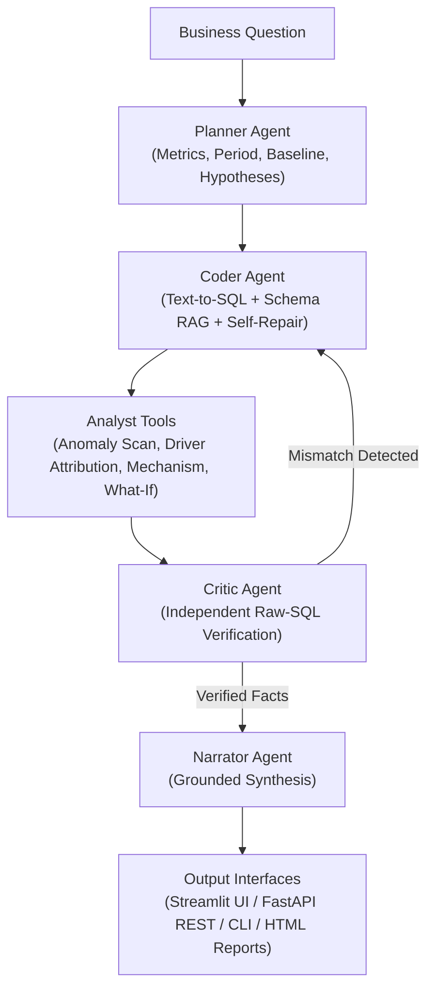

# Autonomous AI Data Analyst Agent

[](https://github.com/shwetarahate13/ai-data-anaylst/actions/workflows/ci.yml)
[](https://www.python.org/downloads/)
[](https://duckdb.org/)
[](https://fastapi.tiangolo.com/)
[](https://streamlit.io/)
[](LICENSE)

An enterprise-ready, multi-agent AI data analyst that **investigates** complex business questions end-to-end like a senior quantitative analyst, rather than just returning raw SQL queries.

```bash
$ python -m analyst investigate "Why did revenue drop in Q3?"

Revenue fell 10.3% in Q3 2024 vs Q2 2024 ($1.11M to $997.1K, -$114.7K).
- Where it came from: repeat customers in the West region moved -$149.8K, more than the entire net
  change (-$114.7K), because the rest of the business moved +$35.0K.
- Volume vs value: lower order volume accounts for -$129.5K; basket value accounts for +$14.8K.
- Likely mechanism: average delivery time for that segment went from 4.2 to 7.5 days (+3.3 days) versus
  +0.1 days for the rest of the business (z = 61). Review rating also fell from 4.3 to 3.3 stars.
  This is a strong association, not proof of causation.
- Context: versus last year, Q3 2024 revenue was -1.3% (the preceding quarter was +16.9%).
- What-if (estimate): cutting delivery time by 20% in West could have added about $58.7K ($53.3K to $64.2K).
- Confidence: high. 7 of 7 verification checks passed (re-derived from raw tables with independent SQL).
```

---

## 🌟 Core Design Principle: The LLM Never Does Arithmetic

LLMs are prone to hallucinating numbers and mathematical errors. This system enforces strict separation of concerns:

| Layer | Component | Functionality |
|---|---|---|
| **Language** | Multi-Provider LLM (Anthropic / OpenAI / Ollama) | Interprets business questions, writes schema-grounded SQL, and narrates verified conclusions |
| **Numbers** | DuckDB + Pandas | Every number, percentage, and metric delta is computed deterministically in code |
| **Trust** | Critic Agent | Independently verifies every number from raw database tables using self-derived SQL; checks additivity, sample size, and statistical significance |
| **Guardrail** | Grounding Checker | Any LLM summary containing numbers not present in the verified fact store is **automatically rejected** |

Runs **100% offline with zero external API calls** using rule-based parsing and template narration. When configured with an API key, it unlocks intelligent text-to-SQL synthesis, self-repair loops, and narrative synthesis.

---

## 🏗️ Multi-Agent Architecture



### Module Breakdown

| Component | File | Responsibilities |
|---|---|---|
| **Planner** | `analyst/agents.py` | Deconstructs questions into metric targets, comparison periods, and hypotheses |
| **Coder** | `analyst/agents.py`, `analyst/rules_sql.py` | Schema RAG, text-to-SQL generation, AST sandbox validation, and self-repair (up to 3 retries) |
| **SQL Gateway** | `analyst/db.py` | Read-only gateway, blocked keywords/functions, external file access disabled, config locked |
| **Schema RAG** | `analyst/schema_rag.py` | TF-IDF retrieval over database schemas and business glossary (`analyst/glossary.json`) |
| **Anomaly Detection** | `analyst/tools/anomaly.py` | Scan statistic on year-over-year per-day growth + Isolation Forest second opinion (seasonality-safe) |
| **Attribution** | `analyst/tools/drivers.py` | Greedy multi-dimensional drill-down with excess-concentration test and volume/price decomposition |
| **What-If Simulation** | `analyst/tools/whatif.py` | Two-way fixed-effects panel elasticity model with confidence intervals and extrapolation guardrails |
| **Critic** | `analyst/critic.py` | 7 automated verification checks driving high/medium/low confidence scores |
| **Sandbox** | `analyst/sandbox.py` | Isolated subprocess with AST node whitelist, resource limits, and timeout protection |
| **Orchestrator** | `analyst/agent.py` | End-to-end agent workflow coordinating Planner, Coder, Analyst, Critic, and Narrator |

---

## ⚡ Quickstart

### 1. Installation

```bash
# Clone the repository
git clone https://github.com/shwetarahate13/ai-data-anaylst.git
cd ai-data-anaylst

# Create and activate virtual environment
python3 -m venv .venv
source .venv/bin/activate

# Install dependencies
pip install -r requirements.txt
```

### 2. Configure Environment (Optional)

```bash
cp .env.example .env
```

Edit `.env` to configure your preferred LLM provider:
- **Offline Mode**: Leave keys blank (runs 100% offline with zero cost).
- **Anthropic Claude**: Set `ANTHROPIC_API_KEY=sk-ant-...`
- **OpenAI**: Set `OPENAI_API_KEY=sk-...` and `OPENAI_MODEL=gpt-4o-mini`
- **Ollama (Local)**: Set `LLM_PROVIDER=ollama`, `OLLAMA_BASE_URL=http://localhost:11434/v1`, and `OLLAMA_MODEL=llama3.2`

### 3. Run the Streamlit Web Application

```bash
streamlit run app/streamlit_app.py
```
Open [http://localhost:8501](http://localhost:8501) in your browser:
- **Root-Cause Investigation**: Interactive waterfall bridges, timeline scans, and mechanism charts.
- **Ask the Data**: Natural language text-to-SQL with auto-generated charts and CSV exports.
- **What-If Simulation**: Scenario modeling for operational improvements with interactive sliders.
- **Data Explorer & Ingestion**: Live database table schema browser and custom CSV file uploader.

### 4. Run the REST API

```bash
uvicorn api.main:app --reload --port 8000
```
Interactive OpenAPI documentation is available at [http://127.0.0.1:8000/docs](http://127.0.0.1:8000/docs).

### 5. CLI Usage

```bash
# Run investigation with full trace and HTML report generation
python -m analyst investigate "Why did revenue drop in Q3?" --report --trace

# Ask ad-hoc SQL questions
python -m analyst ask "Top 3 categories by revenue in Q3 2024"

# Run what-if scenario
python -m analyst whatif --reduction 0.25 --region West

# Inspect database tables and schemas
python -m analyst tables
python -m analyst tables --schema v_orders

# Run custom validated SQL query
python -m analyst query "SELECT region, COUNT(*) FROM v_orders GROUP BY 1"
```

---

## 🐳 Docker & Docker Compose

Deploy the UI and API simultaneously with Docker Compose:

```bash
docker compose up --build
```
- **Streamlit Web UI**: [http://localhost:8501](http://localhost:8501)
- **FastAPI REST API**: [http://localhost:8000](http://localhost:8000) (Swagger at `/docs`)

---

## 🧪 Testing and Evaluation

Run the test suite (51 unit and integration tests):
```bash
pytest -v
```

Run the benchmark evaluation (50 text-to-SQL questions + 8 root-cause cases):
```bash
python -m eval.run_eval --offline
```

### Benchmark Results (Offline Baseline)

| Benchmark | Accuracy | Notes |
|---|---|---|
| **Text-to-SQL (50 questions)** | **78% (39/50)** | Easy: 90%, Medium: 93%, Hard: 20% (Offline rules) |
| **Root-Cause Accuracy (8 cases)** | **100% (8/8)** | 6 injected ground-truth cases + 2 negative controls |

---

## 📁 Repository Structure

```
ai-data-analyst/
├── analyst/                  # Core agent package
│   ├── agent.py              # Orchestrator & Investigation coordinator
│   ├── agents.py             # Planner, Coder, and Narrator agent implementations
│   ├── bootstrap.py          # Data generation and database setup
│   ├── cli.py                # Command-line interface
│   ├── config.py             # Settings and environment loader
│   ├── critic.py             # 7 independent verification checks
│   ├── data_gen.py           # Synthetic e-commerce generator with injected ground truth
│   ├── db.py                 # DuckDB secure SQL gateway & schema inspector
│   ├── glossary.json         # Business metric definitions for schema RAG
│   ├── knowledge.py          # Semantic documentation chunks
│   ├── llm.py                # Multi-provider client (Anthropic, OpenAI, Ollama)
│   ├── report.py             # HTML/Markdown generation and Plotly chart builders
│   ├── rules_sql.py          # Rule-based fallback text-to-SQL parser
│   ├── sandbox.py            # AST-validated Python sandbox with rlimits
│   ├── schema_rag.py         # TF-IDF retrieval over schemas and glossary
│   ├── utils.py              # Number formatting, date windows, Trace logger
│   └── tools/                # Statistical & econometric toolset
│       ├── anomaly.py        # Scan-statistic seasonality-safe anomaly detection
│       ├── drivers.py        # Attribution drill-down, volume/price split, diff-in-diff
│       └── whatif.py         # Two-way fixed effects panel regression
├── api/                      # Production REST API
│   └── main.py               # FastAPI application with CORS and endpoints
├── app/                      # Interactive Web UI
│   └── streamlit_app.py      # Streamlit app with tabs, charts, explorer, uploader
├── data/                     # Data directory (shop.duckdb, ground_truth.json)
├── eval/                     # Evaluation harness
│   ├── questions.py          # 50 gold standard SQL evaluation questions
│   └── run_eval.py           # Evaluation runner
├── reports/                  # Generated HTML and Markdown investigation reports
├── tests/                    # 51 unit & integration tests
│   ├── conftest.py           # Shared fixtures & FakeLLM
│   ├── test_agent.py         # Root cause, critic, and narration tests
│   ├── test_ask.py           # Text-to-SQL, self-repair, and sandbox tests
│   ├── test_core.py          # SQL security, sandbox limits, anomaly tests
│   ├── test_interfaces.py    # FastAPI endpoints and report generation tests
│   └── test_real_world.py    # OpenAI, multi-provider, table inspection, CSV upload tests
├── .github/workflows/ci.yml  # Automated CI testing workflow
├── Dockerfile                # Production container image
├── docker-compose.yml        # Multi-container orchestration (UI + API)
├── Makefile                  # Developer workflow commands
├── requirements.txt          # Python package dependencies
└── README.md                 # Project documentation
```

---

## 📄 License

MIT License. See [LICENSE](LICENSE) for details.
